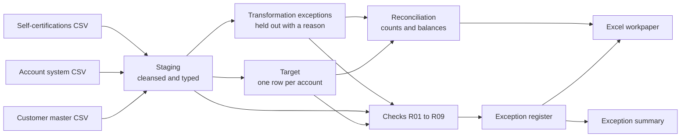

# FATCA and CRS data checks

An end-to-end data-checking workflow for FATCA and CRS customer tax
reporting, built on synthetic data for a fictional Australian financial
institution. Three source extracts are mapped to one reporting dataset, nine
named checks raise an exception register, every record and balance is
reconciled, and the results land in an Excel workpaper and a one-page
summary.

> **Disclaimer.** All data is synthetic: the people, accounts and tax
> identifiers are fictional, and every TIN follows the obviously fake pattern
> `AU-FAKE-123456789`. The rules are a simplified, documented subset of common
> FATCA and CRS checks. This is an educational model, not tax advice, not a
> complete implementation of FATCA or CRS, and not affiliated with any
> organisation.

## What it shows

- **Source-to-target mapping:** every target field with its source, rule and
  handling of missing or invalid values ([docs/MAPPING.md](docs/MAPPING.md))
- **Cleansing and transformation in SQL** (DuckDB): dates, country names to
  ISO codes, currencies, case and spacing, with no record silently dropped
- **Business rules as data tests:** nine named rules (R01 to R09), each in
  plain English with sources, then SQL ([docs/RULES.md](docs/RULES.md)), and
  pytest tests on hand-made fixtures
- **Reconciliation:** record counts and year-end balance control totals by
  currency, source against target against held out
- **Honest measurement:** checks scored against planted issues, including
  unseen variants the checks were not designed on
- **Excel and MI:** a workpaper with live formulas, a filterable exception
  register, lookups and summaries
  ([outputs/exception_workpaper.xlsx](outputs/exception_workpaper.xlsx))
- **Client-ready writing:** a one-page summary for a non-technical reader
  ([docs/EXCEPTION_SUMMARY.md](docs/EXCEPTION_SUMMARY.md))

## Flow



## Results

All figures below are measured outputs of the pipeline.

| Measure | Result |
|---|---|
| Source records | 2,000 customers, 3,000 accounts, 1,960 self-certifications |
| Record reconciliation | All OK: accounts 3,000 = 2,970 in target + 30 held out; customers 2,000 = 1,960 + 40; self-certifications 1,960 = 1,920 + 40 |
| Balance control totals | OK in all 7 currency lines (6 currencies plus unreadable), and the staging total matches an independent sum of the raw file (90,319,017.43) |
| Exception register | 372 exceptions: High 200, Medium 121, Low 51, across 329 of 2,000 customers |
| Self-certification completeness | 92.6% of target accounts (2,751 of 2,970) |
| Staging step | 450 of 450 planted format variants standardised to the correct value |
| Workbook check in Excel | 19,738 formulas, 0 in error; 78 of 78 key cells match the database |
| Tests | 32 pytest tests pass |

### How well the checks work

| Dataset | Rules tested | Planted issues | Caught | Missed | False positives |
|---|---|---|---|---|---|
| Main (2,000 customers) | Current | 372 | 372 | 0 | 0 |
| Unseen round 1 (41 customers, seed 4242) | First version | 28 | 17 | 11 | 13 |
| Unseen round 2 (38 customers, seed 7777) | Current | 28 | 19 | 9 | 8 |

**The main answer key was designed alongside the checks, so the
unseen-variant scores are the fairer measure of how the checks would hold
up.** Each unseen round uses its own seed and issue variants that appear in no
earlier dataset, was written before its result was seen, and was scored once
without tuning.

Round 1 found gaps in duplicate matching, TIN placeholders, US indicia
spellings and placeholder dates, and the rules were improved in response.
Round 2 was then written fresh to test the improved rules. In round 2, 5 of
the 9 misses were still raised on the same record by another rule and 4 were
raised by no rule at all. Every miss and false positive is explained in
[docs/RULES.md](docs/RULES.md#results).

Known risks, documented and not yet fixed:

- A balance written in European style (12.345,67) is read as 12.35 without
  any exception. Reconciliation cannot catch it, because the source total is
  parsed the same way.
- Duplicate matching on name and date of birth flags twins, so a manual
  review step remains.

## How to run

Python 3.12 on Windows. One command per step, from the project folder:

```
python -m venv .venv
.venv\Scripts\pip install -r requirements.txt
.venv\Scripts\python src\generate.py
.venv\Scripts\python src\generate_unseen.py
.venv\Scripts\python src\generate_unseen_round2.py
.venv\Scripts\python src\checks.py
.venv\Scripts\python src\checks.py --unseen round1
.venv\Scripts\python src\checks.py --unseen round2
.venv\Scripts\python src\build_rules_doc.py
.venv\Scripts\python src\build_summary_doc.py
.venv\Scripts\python src\build_workbook.py
.venv\Scripts\python src\verify_workbook.py
.venv\Scripts\python -m pytest
```

| Step | What it does |
|---|---|
| `generate.py` | Writes the three source extracts (fixed seed 20260630) and the answer key of 822 planted issues |
| `generate_unseen.py`, `generate_unseen_round2.py` | Write the two small unseen-variant datasets |
| `checks.py` | Runs the transformation, rules, reconciliation and scoring; writes the DuckDB database and `outputs/exception_register.csv` |
| `checks.py --unseen round1` / `round2` | Scores the rules on an unseen-variant dataset |
| `build_rules_doc.py`, `build_summary_doc.py` | Write docs/RULES.md and docs/EXCEPTION_SUMMARY.md from the code and measured results |
| `build_workbook.py` | Writes the Excel workpaper |
| `verify_workbook.py` | Recalculates the workpaper in Microsoft Excel (Windows only) and checks it, without saving |

## The workbook

`outputs/exception_workpaper.xlsx` uses real formulas over its data sheets, so
it recalculates when data or exception statuses change:

- **Summary:** record and balance reconciliation with COUNTIFS and SUMIFS and
  OK/BREAK checks, exceptions by rule and severity, self-certification
  completeness, and a live count of exception statuses
- **Exception register:** an Excel table with filters, Status and Owner
  dropdowns, and row colours by severity
- **Lookup:** type an account_id to see its customer and exceptions, using
  XLOOKUP with INDEX-MATCH beside it for older Excel
- **Rule x country:** exceptions by rule and country, built with COUNTIFS
  formulas (openpyxl cannot reliably create a real pivot table)
- **Check scores, Mapping**, and the Accounts, Customers and Self-certs data
  sheets

LibreOffice was not available for the recalculation check, so
`verify_workbook.py` uses Microsoft Excel instead.

## Project layout

- `data/raw/`: generated source extracts
- `data/injected_issues.csv`: answer key of planted issues (used only for scoring)
- `data/unseen/round1/`, `data/unseen/round2/`: unseen-variant datasets and answer keys
- `src/`: generation, SQL transformation and rules, reporting and workbook code
- `docs/`: mapping, rules and exception summary
- `outputs/`: exception workpaper and register (kept in the repository so reviewers can open them)
- `tests/`: offline pytest tests

## Sources

- OECD (2025), *Consolidated text of the Common Reporting Standard*,
  https://doi.org/10.1787/055664b1-en
- Agreement between Australia and the United States to implement FATCA
  (2014), Annex I,
  https://treasury.gov.au/sites/default/files/2019-03/Australia-US-FATCA-IGA.pdf

Section references for each rule are in [docs/RULES.md](docs/RULES.md).
